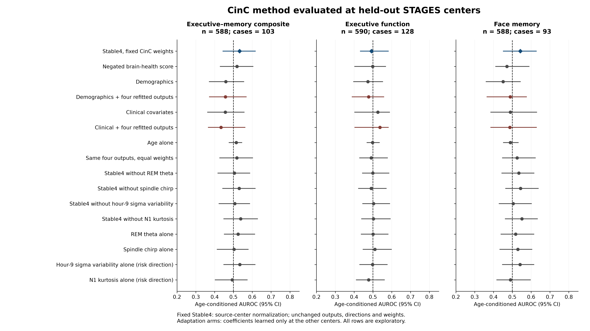

# STAGES validation of the CinC cognitive-risk method

The published Stable4 method did not establish discrimination of low composite performance above chance in STAGES.

Among 588 participants, 103 met the existing low-composite definition. Stable4 produced an age-conditioned AUROC of **0.533 (95% CI 0.445–0.616)**, based on 2,193 eligible case–noncase pairs.

The center-level point estimates were in the expected direction in 4 of four centers: Geisinger 0.600; MedSleep 0.527; St Lukes 0.607; Stanford 0.545. This is directional concordance, with an imprecise pooled estimate. Geisinger and St Luke’s contributed only 15 and 28 eligible pairs, respectively.

The four outputs, signs, and weights were unchanged. Normalization was estimated exclusively from the other three centers in each fold, using the exact submitted implementation. This replicates the CinC development method; it does not use the still-pending reconstructed HSP normalizer. The endpoint is concurrent sample-relative low cognitive performance, rather than the Challenge’s later clinical diagnosis.

The extension was committed before its first metric was computed: `02cbde05d02c49349d565ff173224f9acffdb4fc`. Earlier continuous and within-center-normalization results were already known; this extension is explicitly post hoc. The analysis completed at 2026-10-28T00:14:24.684441+00:00.

## Complete model results

All intervals below are nominal percentile 95% intervals from 2,000 participant bootstrap samples stratified by center. Every sample repeats outcome adjustment, labeling, source normalization, and all trained fits. AUROC uses within-center pairs with age difference at most two years. Holm p-values adjust the 33 outcome-blind score/outcome tests together. No permutation p-value is assigned to a trained classifier.

### Executive–memory composite

n = 588; cases = 103; eligible pairs = 2,193.

| Model | Age-conditioned AUROC (95% CI) | Equal-center AUROC | Ordinary within-center AUROC | Holm p |
|---|---:|---:|---:|---:|
| Stable4, fixed CinC weights | 0.533 (0.445–0.616) | 0.570 | 0.498 | 1.0000 |
| Same four outputs, equal weights | 0.518 (0.427–0.602) | 0.558 | 0.499 | 1.0000 |
| Stable4 without REM theta | 0.505 (0.418–0.587) | 0.593 | 0.507 | 1.0000 |
| Stable4 without spindle chirp | 0.531 (0.443–0.616) | 0.556 | 0.509 | 1.0000 |
| Stable4 without hour-9 sigma variability | 0.507 (0.423–0.586) | 0.529 | 0.494 | 1.0000 |
| Stable4 without N1 kurtosis | 0.539 (0.449–0.628) | 0.552 | 0.500 | 1.0000 |
| REM theta alone | 0.524 (0.451–0.613) | 0.470 | 0.487 | 1.0000 |
| Spindle chirp alone | 0.503 (0.414–0.578) | 0.536 | 0.504 | 1.0000 |
| Hour-9 sigma variability alone (risk direction) | 0.534 (0.449–0.615) | 0.590 | 0.518 | 1.0000 |
| N1 kurtosis alone (risk direction) | 0.493 (0.403–0.573) | 0.595 | 0.504 | 1.0000 |
| Negated brain-health score | 0.519 (0.430–0.603) | 0.677 | 0.519 | 1.0000 |
| Age alone | 0.515 (0.477–0.545) | 0.528 | 0.512 | — |
| Demographics | 0.459 (0.372–0.555) | 0.472 | 0.460 | — |
| Clinical covariates | 0.456 (0.362–0.557) | 0.374 | 0.455 | — |
| Demographics + four refitted outputs | 0.457 (0.372–0.568) | 0.501 | 0.465 | — |
| Clinical + four refitted outputs | 0.434 (0.367–0.562) | 0.463 | 0.447 | — |

### Executive function

n = 590; cases = 128; eligible pairs = 2,660.

| Model | Age-conditioned AUROC (95% CI) | Equal-center AUROC | Ordinary within-center AUROC | Holm p |
|---|---:|---:|---:|---:|
| Stable4, fixed CinC weights | 0.492 (0.433–0.582) | 0.460 | 0.465 | 1.0000 |
| Same four outputs, equal weights | 0.491 (0.430–0.578) | 0.471 | 0.462 | 1.0000 |
| Stable4 without REM theta | 0.499 (0.445–0.585) | 0.569 | 0.472 | 1.0000 |
| Stable4 without spindle chirp | 0.491 (0.424–0.571) | 0.472 | 0.472 | 1.0000 |
| Stable4 without hour-9 sigma variability | 0.504 (0.446–0.589) | 0.478 | 0.480 | 1.0000 |
| Stable4 without N1 kurtosis | 0.503 (0.440–0.592) | 0.486 | 0.472 | 1.0000 |
| REM theta alone | 0.501 (0.438–0.581) | 0.439 | 0.482 | 1.0000 |
| Spindle chirp alone | 0.511 (0.448–0.598) | 0.595 | 0.483 | 1.0000 |
| Hour-9 sigma variability alone (risk direction) | 0.498 (0.430–0.576) | 0.486 | 0.487 | 1.0000 |
| N1 kurtosis alone (risk direction) | 0.477 (0.412–0.561) | 0.526 | 0.480 | 1.0000 |
| Negated brain-health score | 0.499 (0.404–0.568) | 0.595 | 0.476 | 1.0000 |
| Age alone | 0.498 (0.469–0.534) | 0.520 | 0.466 | — |
| Demographics | 0.473 (0.398–0.552) | 0.363 | 0.523 | — |
| Clinical covariates | 0.526 (0.404–0.589) | 0.438 | 0.552 | — |
| Demographics + four refitted outputs | 0.477 (0.390–0.558) | 0.371 | 0.519 | — |
| Clinical + four refitted outputs | 0.537 (0.404–0.582) | 0.457 | 0.553 | — |

### Face memory

n = 588; cases = 93; eligible pairs = 1,852.

| Model | Age-conditioned AUROC (95% CI) | Equal-center AUROC | Ordinary within-center AUROC | Holm p |
|---|---:|---:|---:|---:|
| Stable4, fixed CinC weights | 0.542 (0.452–0.627) | 0.474 | 0.532 | 1.0000 |
| Same four outputs, equal weights | 0.525 (0.447–0.622) | 0.479 | 0.526 | 1.0000 |
| Stable4 without REM theta | 0.535 (0.444–0.615) | 0.488 | 0.534 | 1.0000 |
| Stable4 without spindle chirp | 0.544 (0.465–0.638) | 0.489 | 0.532 | 1.0000 |
| Stable4 without hour-9 sigma variability | 0.504 (0.430–0.601) | 0.464 | 0.510 | 1.0000 |
| Stable4 without N1 kurtosis | 0.551 (0.463–0.633) | 0.474 | 0.540 | 1.0000 |
| REM theta alone | 0.517 (0.440–0.614) | 0.414 | 0.507 | 1.0000 |
| Spindle chirp alone | 0.529 (0.434–0.604) | 0.504 | 0.528 | 1.0000 |
| Hour-9 sigma variability alone (risk direction) | 0.541 (0.448–0.614) | 0.555 | 0.533 | 1.0000 |
| N1 kurtosis alone (risk direction) | 0.490 (0.418–0.596) | 0.575 | 0.486 | 1.0000 |
| Negated brain-health score | 0.471 (0.412–0.589) | 0.618 | 0.477 | 1.0000 |
| Age alone | 0.489 (0.453–0.531) | 0.439 | 0.488 | — |
| Demographics | 0.451 (0.361–0.543) | 0.352 | 0.430 | — |
| Clinical covariates | 0.489 (0.386–0.629) | 0.481 | 0.459 | — |
| Demographics + four refitted outputs | 0.489 (0.365–0.575) | 0.491 | 0.433 | — |
| Clinical + four refitted outputs | 0.487 (0.386–0.628) | 0.435 | 0.450 | — |

## Incremental prediction: every planned comparison

Positive differences favor the model in the first column. The familywise intervals use Bonferroni adjustment for all nine planned contrasts across the three outcomes. The four-output adaptation arms learn new coefficients on source centers and do not validate the unchanged Stable4 score.

| Outcome | Comparison | AUROC difference | Nominal 95% CI | Familywise 95% CI |
|---|---|---:|---:|---:|
| Executive–memory composite | Stable4, fixed CinC weights vs Demographics | +0.073 | -0.055 to +0.187 | -0.118 to +0.236 |
| Executive–memory composite | Demographics + four refitted outputs vs Demographics | -0.002 | -0.070 to +0.091 | -0.108 to +0.125 |
| Executive–memory composite | Clinical + four refitted outputs vs Clinical covariates | -0.022 | -0.057 to +0.068 | -0.084 to +0.098 |
| Executive function | Stable4, fixed CinC weights vs Demographics | +0.019 | -0.076 to +0.136 | -0.112 to +0.174 |
| Executive function | Demographics + four refitted outputs vs Demographics | +0.004 | -0.064 to +0.077 | -0.109 to +0.120 |
| Executive function | Clinical + four refitted outputs vs Clinical covariates | +0.011 | -0.053 to +0.056 | -0.083 to +0.099 |
| Face memory | Stable4, fixed CinC weights vs Demographics | +0.092 | -0.037 to +0.218 | -0.092 to +0.258 |
| Face memory | Demographics + four refitted outputs vs Demographics | +0.038 | -0.065 to +0.106 | -0.093 to +0.144 |
| Face memory | Clinical + four refitted outputs vs Clinical covariates | -0.002 | -0.062 to +0.058 | -0.099 to +0.088 |

## Center-level results for the composite

| Center | n | Cases | Eligible pairs | Stable4 | Demographics | Demographics + four |
|---|---:|---:|---:|---:|---:|---:|
| Geisinger | 34 | 8 | 15 | 0.600 | 0.700 | 0.667 |
| MedSleep | 305 | 60 | 1,666 | 0.527 | 0.480 | 0.472 |
| St Lukes | 50 | 9 | 28 | 0.607 | 0.321 | 0.464 |
| Stanford | 199 | 26 | 484 | 0.545 | 0.387 | 0.399 |

Equal-center Stable4 intervals had 1,976/2,000 valid replicates; all four centers must contribute pairs for a replicate to count. The pooled metric retains every eligible pair. Pair counts are not independent sample sizes.

## What this adds to the manuscript

This is a direct, outcome-aligned replication of the published four-output cognitive-risk method. It tests whether a compact score developed for later impairment ranks concurrent low performance at held-out sleep centers. It also tests, separately, whether source-center adaptation of the same output roster improves prediction.

Cognitive prediction from STAGES PSG is already represented in the literature. Khajehpiri and colleagues used EEG and ECG in 817 participants, dichotomized PCET concept-level responses at the sample median, and used subject-based ten-fold cross-validation. Their task and metric differ from the age-conditioned, adjusted low-performance endpoint here. The distinctive question for this study is transport of a previously selected four-output score across centers. [Khajehpiri et al., IEEE EMBC 2025; author manuscript](https://arxiv.org/html/2506.00279v1).

None of the nine planned incremental contrasts had a familywise interval wholly above zero. This extension therefore does not supply evidence for incremental cross-center prediction after accounting for the full comparison family.

The result does not determine what the original HSP-normalized score will show; that reconstruction remains a separate analysis. No additional endpoint, threshold, subgroup, sign flip, model family, or feature search was added in response to these results.

The existing AHI pipeline check remains 0.761 (95% CI 0.704–0.812). It demonstrates detection of that respiratory signal under the rank procedure; it does not establish power for a smaller cognitive association.

## Figures

The forest plot displays every model and outcome, without selecting favorable rows. Intervals are nominal 95% percentile intervals. The dashed line marks chance. No Challenge and STAGES estimates are pooled.

## Input and implementation audit after the result was challenged

| Check | Evidence |
|---|---|
| Participant alignment and cached features | All 590 subject caches match the analysis inputs exactly; all have the same checkpoint and extraction source hashes. |
| Original CNB records | All 590 selected source rows recovered uniquely; PCET and face-memory scores match exactly; PCET formula differences are limited to source rounding (maximum 0.00005). |
| Independent projection from checkpoint tensors | Four outputs recomputed from all 590 latents; maximum absolute difference 4.52e-07, under 8.68e-07 output SD. |
| Raw EDF re-extraction | One outcome-blind selected record per center; all four reproduce the cached spectrogram hash, latent, four outputs, and brain-health score exactly. Both native and derived C4–M1 routes are represented. |
| Original HSP development result | The submitted scorer reproduces macro age-conditioned AUROC 0.754144 and each reported site estimate. |
| Submitted metric | The Challenge entry’s independent pair-AUROC function exactly reproduces all three new STAGES estimates. |

These checks identified no scoring, indexing, head-mapping, voltage-scaling, or selected-record extraction discrepancy. Fresh raw-signal re-extraction covers four audit records, not all 590 EDFs.

A separate method-reproduction omission was identified: the source reconstruction had discarded feature taps required by the optional CARR branch. Amendment 07 retains future taps and preserves the first 102 latent files without changes. This affects our ability to reconstruct the full submitted system; it does not change the standalone Stable4 estimates above.

The current STAGES case definition is a covariate-adjusted concurrent-performance phenotype. It is not the later diagnosis label used in the Challenge. The original organizer-trained artifact and deployment logs remain unavailable, and the reconstructed HSP-normalization result is pending. The 0.533 estimate must not be presented as a completed evaluation of the exact organizer-trained system.
