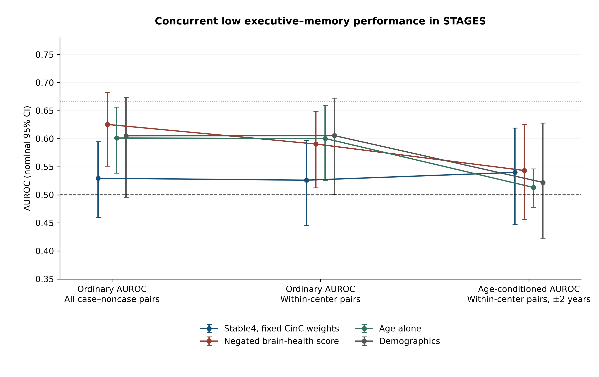

# Ordinary and age-conditioned cognitive prediction in STAGES

**Without age conditioning**, the fixed Stable4 score has ordinary AUROC **0.529 (0.459–0.595)**. The negated brain-health score has ordinary AUROC **0.625 (0.551–0.682)**. This uses the corrected, source-reference-defined low-performance composite; it is a different target from the earlier full-cohort residual phenotype.

There are 104 low-performance cases among 588 eligible participants, with 2,065 eligible age-matched within-center pairs. The new plan/code were frozen at `6c973b463cc4baa2233ec064f059cf463a311ef6` before this extension was computed. Earlier results were already known. All new results are exploratory; the original endpoints are retained.

## The effect of center pairing and age conditioning

| Model | Ordinary, all pairs | Ordinary, within center | Age-conditioned, within center |
|---|---:|---:|---:|
| Stable4, fixed CinC weights | 0.529 (0.459–0.595) | 0.526 (0.445–0.597) | 0.540 (0.448–0.619) |
| Negated brain-health score | 0.625 (0.551–0.682) | 0.591 (0.512–0.649) | 0.543 (0.456–0.626) |
| Age alone | 0.601 (0.539–0.656) | 0.600 (0.526–0.660) | 0.513 (0.477–0.546) |
| Demographics | 0.605 (0.495–0.673) | 0.605 (0.501–0.672) | 0.522 (0.423–0.628) |
| Demographics + four refitted outputs | 0.600 (0.486–0.672) | 0.600 (0.498–0.669) | 0.529 (0.421–0.623) |
| Clinical covariates | 0.594 (0.474–0.664) | 0.584 (0.478–0.657) | 0.512 (0.409–0.617) |
| Clinical + four refitted outputs | 0.592 (0.471–0.665) | 0.584 (0.475–0.654) | 0.515 (0.411–0.617) |

The brain-health score minus demographics is +0.020 AUROC (paired 95% CI -0.057 to +0.118). This additional post hoc diagnostic interval is not multiplicity-adjusted. The positive ordinary-AUROC association therefore does not by itself establish incremental prediction beyond demographics.

Changing from all-pair ordinary AUROC to within-center age-conditioned AUROC changes both center pairing and age pairing. The middle column makes that distinction visible. These differences are descriptive effects of pair eligibility and weighting, not a causal decomposition of the score.

## Why the expectation of at least 0.667 is not supported

1. The organizer-scored test entry had ordinary AUROC 0.749 and age-conditioned AUROC 0.622. A minimum age-conditioned AUROC of 0.667 would already exceed that test result. The validation figures were 0.738 and 0.723. [Official Challenge results](https://moody-challenge.physionet.org/2026/results/).

2. The HSP development sample is substantially older: mean 67.0 years versus 44.2 in STAGES; 79.0% versus 15.6% are at least 60. These are the selected development cache and STAGES sample, not the unknown hidden-site age distributions.

3. The Challenge outcome is a later clinical diagnosis; STAGES supplies concurrent task performance. The corrected target is low raw executive-plus-memory performance relative to source-center reference values. It does not create a clinical MCI or dementia diagnosis. A score can discriminate later clinical diagnoses yet show weak concurrent task associations in a younger clinical sample. This is an explanation to investigate, not a proven mechanism.

4. The actual Stable4 associations with the available raw tests are small: Pearson r = -0.070 for PCET and -0.089 for face memory (higher risk should correlate negatively with better performance). They remain weak before outcome residualization, so residualization alone cannot explain the weak fixed-score discrimination.

5. Brain-health risk correlates with age at r = 0.459. Its ordinary discrimination decreases with within-center age matching, while the fixed Stable4 result changes little. Ordinary and age-independent discrimination answer different questions.

6. Four outputs and their weights were selected on the same 338-person development benchmark used for its reported source cross-validation. That development estimate is conditional on selection. The organizer-scored hidden test is the more independent reference for expectation; its selected deployment branch still needs original logs or a clearly labeled reconstruction.

## Checks against an inference or data-processing mistake

The separate input audit verified all 590 participant/feature joins and cognitive source rows; independent checkpoint projection agrees to under 0.000001 output SD. Fresh EDF extraction at one record per center reproduces the cached outputs exactly. The same scorer reproduces HSP development macro AUROC 0.754144.

Current source inference was also compared with 14 matched historical HSP participants. Ages and sex codes agree; four-head new/old correlations exceed 0.999997. Median latent relative difference is 0.000741. This matched subset gives no evidence of a large inference-path shift; it is not a raw-signal audit of every historical record.

A real design issue affected the newly fitted classifiers against full-cohort residual labels. A 1,000-replicate null simulation gave demographic AUROC 0.478 with full-cohort fitted residual cases versus 0.499 with independently defined residual cases. Those older fitted binary contrasts are retained as audit diagnostics. In this corrected extension, every label reference, feature normalization, and coefficient fit uses only the source centers.

The reconstructed HSP-normalization endpoint is still pending. The source reconstruction now retains CARR feature taps; the first 102 records need separate backfill for a full branch replay. This does not change any earlier fixed-score result. The exact original organizer artifact and selected branch remain unavailable.

## All outcomes and all models

Intervals are nominal 95% patient bootstrap intervals (2,000 resamples stratified by center). Outcome reference values, labels, source preprocessing and model fits are repeated in each resample. No models, features, thresholds or outcomes were selected from this table.

### Executive–memory composite

n = 588; low-performance cases = 104; age-matched pairs = 2,065.

| Model | Ordinary, all pairs | Ordinary, within center | Age-conditioned | Holm p for age-conditioned fixed score |
|---|---:|---:|---:|---:|
| Stable4, fixed CinC weights | 0.529 (0.459–0.595) | 0.526 (0.445–0.597) | 0.540 (0.448–0.619) | 1.0000 |
| Same four outputs, equal weights | 0.551 (0.480–0.619) | 0.532 (0.453–0.600) | 0.532 (0.440–0.610) | 1.0000 |
| Stable4 without REM theta | 0.570 (0.498–0.634) | 0.539 (0.462–0.609) | 0.521 (0.432–0.601) | 1.0000 |
| Stable4 without spindle chirp | 0.522 (0.456–0.584) | 0.523 (0.448–0.590) | 0.530 (0.446–0.617) | 1.0000 |
| Stable4 without hour-9 sigma variability | 0.513 (0.439–0.574) | 0.527 (0.449–0.594) | 0.524 (0.434–0.603) | 1.0000 |
| Stable4 without N1 kurtosis | 0.519 (0.447–0.585) | 0.523 (0.442–0.594) | 0.546 (0.452–0.631) | 1.0000 |
| REM theta alone | 0.466 (0.392–0.526) | 0.494 (0.421–0.557) | 0.524 (0.442–0.602) | 1.0000 |
| Spindle chirp alone | 0.536 (0.472–0.595) | 0.533 (0.460–0.600) | 0.516 (0.429–0.598) | 1.0000 |
| Hour-9 sigma variability alone (risk direction) | 0.542 (0.479–0.608) | 0.523 (0.451–0.594) | 0.538 (0.455–0.623) | 1.0000 |
| N1 kurtosis alone (risk direction) | 0.555 (0.493–0.620) | 0.535 (0.465–0.601) | 0.502 (0.418–0.583) | 1.0000 |
| Negated brain-health score | 0.625 (0.551–0.682) | 0.591 (0.512–0.649) | 0.543 (0.456–0.626) | 1.0000 |
| Age alone | 0.601 (0.539–0.656) | 0.600 (0.526–0.660) | 0.513 (0.477–0.546) | — |
| Demographics | 0.605 (0.495–0.673) | 0.605 (0.501–0.672) | 0.522 (0.423–0.628) | — |
| Clinical covariates | 0.594 (0.474–0.664) | 0.584 (0.478–0.657) | 0.512 (0.409–0.617) | — |
| Demographics + four refitted outputs | 0.600 (0.486–0.672) | 0.600 (0.498–0.669) | 0.529 (0.421–0.623) | — |
| Clinical + four refitted outputs | 0.592 (0.471–0.665) | 0.584 (0.475–0.654) | 0.515 (0.411–0.617) | — |

| Center | n | Cases | Age-matched pairs | Stable4 | Brain-health risk |
|---|---:|---:|---:|---:|---:|
| Geisinger | 34 | 10 | 18 | 0.667 | 0.833 |
| MedSleep | 305 | 59 | 1605 | 0.537 | 0.520 |
| St Lukes | 50 | 10 | 25 | 0.560 | 0.720 |
| Stanford | 199 | 25 | 417 | 0.544 | 0.609 |

### Executive function

n = 590; low-performance cases = 139; age-matched pairs = 2,469.

| Model | Ordinary, all pairs | Ordinary, within center | Age-conditioned | Holm p for age-conditioned fixed score |
|---|---:|---:|---:|---:|
| Stable4, fixed CinC weights | 0.537 (0.471–0.598) | 0.531 (0.468–0.590) | 0.535 (0.456–0.598) | 1.0000 |
| Same four outputs, equal weights | 0.555 (0.488–0.613) | 0.536 (0.471–0.594) | 0.533 (0.447–0.595) | 1.0000 |
| Stable4 without REM theta | 0.573 (0.512–0.628) | 0.546 (0.480–0.605) | 0.537 (0.458–0.604) | 1.0000 |
| Stable4 without spindle chirp | 0.531 (0.469–0.589) | 0.527 (0.466–0.583) | 0.528 (0.452–0.592) | 1.0000 |
| Stable4 without hour-9 sigma variability | 0.531 (0.461–0.596) | 0.535 (0.474–0.596) | 0.530 (0.459–0.599) | 1.0000 |
| Stable4 without N1 kurtosis | 0.528 (0.464–0.585) | 0.530 (0.468–0.591) | 0.539 (0.464–0.607) | 1.0000 |
| REM theta alone | 0.490 (0.424–0.555) | 0.499 (0.444–0.561) | 0.507 (0.441–0.578) | 1.0000 |
| Spindle chirp alone | 0.545 (0.488–0.602) | 0.535 (0.472–0.595) | 0.529 (0.453–0.604) | 1.0000 |
| Hour-9 sigma variability alone (risk direction) | 0.535 (0.466–0.595) | 0.532 (0.463–0.588) | 0.533 (0.452–0.599) | 1.0000 |
| N1 kurtosis alone (risk direction) | 0.570 (0.507–0.636) | 0.545 (0.484–0.613) | 0.504 (0.429–0.583) | 1.0000 |
| Negated brain-health score | 0.540 (0.479–0.604) | 0.514 (0.449–0.575) | 0.489 (0.401–0.561) | 1.0000 |
| Age alone | 0.590 (0.540–0.645) | 0.590 (0.539–0.652) | 0.512 (0.481–0.548) | — |
| Demographics | 0.571 (0.473–0.636) | 0.577 (0.485–0.641) | 0.519 (0.411–0.591) | — |
| Clinical covariates | 0.594 (0.482–0.644) | 0.592 (0.487–0.649) | 0.543 (0.420–0.606) | — |
| Demographics + four refitted outputs | 0.587 (0.487–0.649) | 0.585 (0.491–0.648) | 0.543 (0.431–0.609) | — |
| Clinical + four refitted outputs | 0.600 (0.496–0.653) | 0.594 (0.492–0.651) | 0.550 (0.437–0.620) | — |

| Center | n | Cases | Age-matched pairs | Stable4 | Brain-health risk |
|---|---:|---:|---:|---:|---:|
| Geisinger | 34 | 14 | 20 | 0.550 | 0.700 |
| MedSleep | 306 | 62 | 1708 | 0.535 | 0.450 |
| St Lukes | 50 | 15 | 44 | 0.386 | 0.591 |
| Stanford | 200 | 48 | 697 | 0.542 | 0.572 |

### Face memory

n = 588; low-performance cases = 106; age-matched pairs = 2,201.

| Model | Ordinary, all pairs | Ordinary, within center | Age-conditioned | Holm p for age-conditioned fixed score |
|---|---:|---:|---:|---:|
| Stable4, fixed CinC weights | 0.495 (0.434–0.591) | 0.512 (0.446–0.606) | 0.523 (0.441–0.615) | 1.0000 |
| Same four outputs, equal weights | 0.504 (0.445–0.598) | 0.519 (0.451–0.606) | 0.515 (0.437–0.613) | 1.0000 |
| Stable4 without REM theta | 0.526 (0.468–0.598) | 0.530 (0.460–0.598) | 0.519 (0.444–0.605) | 1.0000 |
| Stable4 without spindle chirp | 0.493 (0.432–0.598) | 0.505 (0.437–0.611) | 0.519 (0.442–0.631) | 1.0000 |
| Stable4 without hour-9 sigma variability | 0.480 (0.418–0.572) | 0.496 (0.435–0.575) | 0.500 (0.425–0.586) | 1.0000 |
| Stable4 without N1 kurtosis | 0.500 (0.437–0.590) | 0.513 (0.446–0.604) | 0.531 (0.446–0.621) | 1.0000 |
| REM theta alone | 0.464 (0.399–0.559) | 0.475 (0.412–0.575) | 0.500 (0.426–0.591) | 1.0000 |
| Spindle chirp alone | 0.515 (0.449–0.576) | 0.520 (0.445–0.581) | 0.520 (0.433–0.597) | 1.0000 |
| Hour-9 sigma variability alone (risk direction) | 0.512 (0.444–0.581) | 0.513 (0.441–0.593) | 0.515 (0.431–0.607) | 1.0000 |
| N1 kurtosis alone (risk direction) | 0.499 (0.439–0.585) | 0.512 (0.447–0.584) | 0.519 (0.440–0.606) | 1.0000 |
| Negated brain-health score | 0.582 (0.482–0.638) | 0.553 (0.462–0.612) | 0.547 (0.439–0.618) | 1.0000 |
| Age alone | 0.520 (0.453–0.579) | 0.509 (0.439–0.572) | 0.499 (0.462–0.537) | — |
| Demographics | 0.476 (0.389–0.607) | 0.518 (0.401–0.615) | 0.558 (0.417–0.646) | — |
| Clinical covariates | 0.521 (0.415–0.630) | 0.538 (0.431–0.636) | 0.581 (0.451–0.682) | — |
| Demographics + four refitted outputs | 0.473 (0.387–0.603) | 0.510 (0.411–0.617) | 0.571 (0.426–0.645) | — |
| Clinical + four refitted outputs | 0.510 (0.408–0.627) | 0.525 (0.428–0.631) | 0.574 (0.447–0.678) | — |

| Center | n | Cases | Age-matched pairs | Stable4 | Brain-health risk |
|---|---:|---:|---:|---:|---:|
| Geisinger | 34 | 5 | 13 | 0.538 | 0.769 |
| MedSleep | 305 | 66 | 1733 | 0.522 | 0.530 |
| St Lukes | 50 | 7 | 15 | 0.267 | 0.667 |
| Stanford | 199 | 28 | 440 | 0.539 | 0.607 |

## Every prespecified contrast in this extension

Positive differences favor the first model. Familywise intervals use Bonferroni correction for the nine comparisons in this extension; they do not provide study-wide error control over the full post hoc analysis history.

| Outcome | Comparison | Age-conditioned difference | Nominal 95% CI | Familywise 95% CI |
|---|---|---:|---:|---:|
| Executive–memory composite | Stable4, fixed CinC weights vs Demographics | +0.018 | -0.115 to +0.146 | -0.168 to +0.203 |
| Executive–memory composite | Demographics + four refitted outputs vs Demographics | +0.007 | -0.081 to +0.085 | -0.114 to +0.125 |
| Executive–memory composite | Clinical + four refitted outputs vs Clinical covariates | +0.003 | -0.054 to +0.064 | -0.081 to +0.097 |
| Executive function | Stable4, fixed CinC weights vs Demographics | +0.015 | -0.088 to +0.140 | -0.141 to +0.181 |
| Executive function | Demographics + four refitted outputs vs Demographics | +0.023 | -0.046 to +0.098 | -0.080 to +0.136 |
| Executive function | Clinical + four refitted outputs vs Clinical covariates | +0.006 | -0.040 to +0.076 | -0.064 to +0.098 |
| Face memory | Stable4, fixed CinC weights vs Demographics | -0.035 | -0.157 to +0.149 | -0.209 to +0.217 |
| Face memory | Demographics + four refitted outputs vs Demographics | +0.012 | -0.060 to +0.085 | -0.094 to +0.142 |
| Face memory | Clinical + four refitted outputs vs Clinical covariates | -0.007 | -0.054 to +0.042 | -0.080 to +0.061 |

The dashed horizontal line marks chance (0.5); the dotted line marks the 0.667 comparison reference. Error bars are nominal 95% bootstrap intervals. The plotted outcomes and held-center predictions are identical across the three pair-selection metrics.
