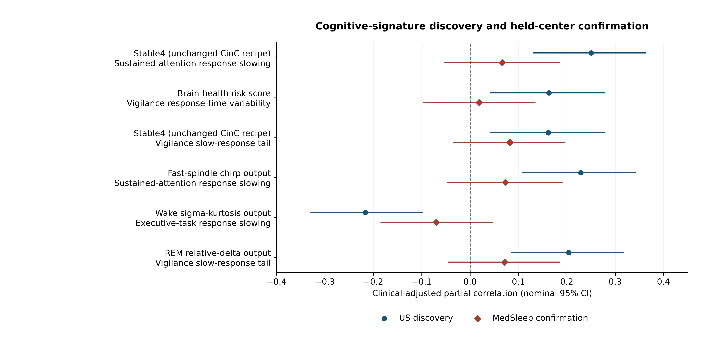

# STAGES unexpected cognitive-signature discovery: completed results

The strongest discovery was **higher unchanged Stable4 risk associated with slower correct sustained-attention responses in the US centers**: adjusted partial r = 0.250, p = 0.000056, discovery FDR q = 0.0018. **It did not meet the frozen confirmation criterion in MedSleep.**

The completed pass tested 32 fixed-score/new-endpoint associations and 8,624 physiology-output/new-endpoint associations. Six candidates were selected using US results alone; 0 of six met same-direction, Holm-adjusted p < .05 at MedSleep. This pass did not produce a confirmed unexpected finding suitable for a positive validation headline.

## What was searched and how confirmation was protected

The discovery cohort contained 284 patients from Stanford, Geisinger and St Luke’s; the confirmation cohort contained 306 MedSleep patients. Task validity and endpoint-specific missingness reduce these counts. This is a center-held replication of previously unanalyzed endpoints, not a wholly untouched study: the earlier accuracy, memory-correct and mean-vigilance results had already been inspected at all centers.

The 16 additional measures covered cognitive flexibility, perseveration, failures to maintain set, response speed, recognition discrimination, confidence-related errors, sustained-attention variability, working memory, vigilance lapses, and the slow-response tail. No new score weights, thresholds or subgroups were selected after confirmation. Verbal memory and the longer working-memory version were excluded for inadequate availability.

Main associations adjusted for an age spline, sex, education, BMI, AHI, Epworth Sleepiness Scale, PHQ-9, recording duration, and discovery-center indicators. Outcomes were rank-normalized within the analysis sample. Results are cross-sectional associations, not effects of an intervention.

Plan and code freeze: `1833ff19818d8413dcc15c6b77ac56b3efe4e6fb`. The exact six discovery selections and all discovery outputs were committed at `57d06310eabaa6c10b2dc58e109a7ddb934203c6` before the MedSleep associations were computed. This is a dated post hoc analysis, not preregistration of the original study.

## Every selected finding

Intervals below are nominal 95% partial-correlation intervals. Discovery q-values adjust the full fixed-score or physiology discovery family. Confirmation p-values are Holm-adjusted separately over the three frozen selections in each track.

| Track / marker | Cognitive measure | Discovery n | Discovery r (95% CI) | Discovery q | Confirmation n | Confirmation r (95% CI) | Confirmation Holm p | Confirmed |
|---|---|---:|---:|---:|---:|---:|---:|---|
| fixed: Stable4 (unchanged CinC recipe) | Sustained-attention response slowing | 274 | 0.250 (0.131 to 0.363) | 0.0018 | 289 | 0.067 (-0.053 to 0.184) | 0.5490 | No |
| fixed: Brain-health risk score | Vigilance response-time variability | 284 | 0.163 (0.043 to 0.278) | 0.0882 | 306 | 0.019 (-0.097 to 0.134) | 0.7492 | No |
| fixed: Stable4 (unchanged CinC recipe) | Vigilance slow-response tail | 284 | 0.162 (0.042 to 0.277) | 0.0882 | 306 | 0.082 (-0.034 to 0.196) | 0.4899 | No |
| physiology: Fast-spindle chirp output | Sustained-attention response slowing | 274 | 0.229 (0.108 to 0.342) | 0.8428 | 289 | 0.073 (-0.047 to 0.190) | 0.6825 | No |
| physiology: Wake sigma-kurtosis output | Executive-task response slowing | 284 | -0.216 (-0.329 to -0.098) | 0.8428 | 306 | -0.070 (-0.184 to 0.046) | 0.6825 | No |
| physiology: REM relative-delta output | Vigilance slow-response tail | 284 | 0.204 (0.085 to 0.317) | 0.8428 | 306 | 0.071 (-0.045 to 0.185) | 0.6825 | No |

One of 32 fixed-score discovery tests survived FDR q < .05. None of the 8,624 physiological-output tests did. The physiology track's best nominal associations should therefore be treated as hypothesis-generating even before their confirmation results.

## Held-center prediction diagnostics

Each diagnostic defines low performance using the US 84.1344746th percentile of endpoint risk. The threshold, feature normalization and clinical predictor coefficients are fit in the US cohort and then applied to MedSleep. There is no held-center threshold tuning. A fixed ridge penalty of 1 is used for the source-fitted clinical predictor and clinical-plus-marker predictor; this routine implementation choice was not tuned to MedSleep performance. These comparisons are conditional on the frozen discovery selections, are exploratory, and are not new confirmatory endpoints.

| Marker / outcome | MedSleep n / cases | Marker ordinary AUROC | Clinical ordinary AUROC | Clinical + marker ordinary AUROC | Paired AUROC difference | Paired MAE difference |
|---|---:|---:|---:|---:|---:|---:|
| Stable4 (unchanged CinC recipe) / Sustained-attention response slowing | 289 / 59 | 0.513 (0.439 to 0.627) | 0.589 (0.467 to 0.670) | 0.590 (0.468 to 0.677) | 0.001 (-0.045 to 0.050) | 0.015 (-0.026 to 0.045) |
| Brain-health risk score / Vigilance response-time variability | 306 / 62 | 0.512 (0.432 to 0.596) | 0.523 (0.406 to 0.614) | 0.538 (0.415 to 0.622) | 0.014 (-0.019 to 0.047) | 0.014 (-0.006 to 0.046) |
| Stable4 (unchanged CinC recipe) / Vigilance slow-response tail | 306 / 55 | 0.551 (0.475 to 0.654) | 0.554 (0.440 to 0.643) | 0.555 (0.445 to 0.648) | 0.001 (-0.029 to 0.044) | -0.004 (-0.033 to 0.023) |
| Fast-spindle chirp output / Sustained-attention response slowing | 289 / 59 | 0.570 (0.483 to 0.665) | 0.589 (0.467 to 0.670) | 0.621 (0.498 to 0.698) | 0.032 (-0.019 to 0.084) | 0.025 (-0.014 to 0.068) |
| Wake sigma-kurtosis output / Executive-task response slowing | 306 / 43 | 0.610 (0.514 to 0.705) | 0.645 (0.530 to 0.740) | 0.636 (0.520 to 0.733) | -0.009 (-0.046 to 0.028) | 0.001 (-0.018 to 0.036) |
| REM relative-delta output / Vigilance slow-response tail | 306 / 55 | 0.556 (0.478 to 0.654) | 0.554 (0.440 to 0.643) | 0.570 (0.460 to 0.660) | 0.016 (-0.014 to 0.059) | -0.003 (-0.033 to 0.025) |

Positive AUROC differences favor adding the marker; negative MAE differences favor adding the marker. A marker may be associated with a continuous outcome without discriminating the source-defined low-performance group. The marker-only score retains the CinC direction for Stable4 and the published orientation for brain-health risk. A new physiology output uses its discovery direction, which was frozen before confirmation.

## Robustness and uncertainty

The 2,000 participant bootstrap resamples were stratified by center and repeated source score normalization, endpoint ranking, nuisance adjustment, source outcome references, and prediction fitting. They conditioned on the frozen selected findings. The selection itself was not repeated. Each candidate also received heteroskedasticity-robust HC3 inference.

| Marker / outcome | Discovery partial r bootstrap CI | Confirmation partial r bootstrap CI | Confirmation HC3 p |
|---|---:|---:|---:|
| Stable4 (unchanged CinC recipe) / Sustained-attention response slowing | 0.250 (0.124 to 0.367) | 0.067 (-0.055 to 0.188) | 0.3190 |
| Brain-health risk score / Vigilance response-time variability | 0.163 (0.053 to 0.262) | 0.019 (-0.105 to 0.137) | 0.7629 |
| Stable4 (unchanged CinC recipe) / Vigilance slow-response tail | 0.162 (0.038 to 0.284) | 0.082 (-0.028 to 0.195) | 0.1731 |
| Fast-spindle chirp output / Sustained-attention response slowing | 0.229 (0.109 to 0.342) | 0.073 (-0.052 to 0.202) | 0.2748 |
| Wake sigma-kurtosis output / Executive-task response slowing | -0.216 (-0.318 to -0.108) | -0.070 (-0.180 to 0.057) | 0.2632 |
| REM relative-delta output / Vigilance slow-response tail | 0.204 (0.080 to 0.317) | 0.071 (-0.029 to 0.179) | 0.1922 |

## How the CinC results can be used

The prior organizer-scored validation/test estimates, age-conditioned AUROC 0.723 and 0.622, concern later impairment diagnoses from submission 2593. They remain evidence about that submitted system. Whether standalone Stable4 produced those scores requires the deployment artifact/logs or a clearly labeled reconstruction. The submitted date-free system also contained guarded alternative branches. [Official Challenge results](https://moody-challenge.physionet.org/2026/results/).

If the exact fixed score is verified as the deployed branch, the CinC results can corroborate the same score’s cognitive-risk discrimination in a different population. They do not independently validate a newly discovered slowing mechanism, domain contrast, subgroup, or new EEG output. Testing any such claim in HSP requires the corresponding endpoint and frozen analysis.

For this completed pass, the additional obstacle is empirical: the new STAGES slowing association did not confirm at MedSleep. Calling it a CinC-validated unexpected finding would overstate both the STAGES confirmation and the meaning of the old Challenge estimates.

## Novelty assessment

Sleep EEG associations with processing speed are established in prior work; a new paper would need more than discovering that speed correlates with EEG. The potentially distinctive finding here was a previously selected compact risk score associating with sustained-attention speed despite weak accuracy prediction. Because that pattern did not confirm at the held center, it remains a candidate rather than an established new cognitive signature. See Djonlagic et al., [Macro and micro sleep architecture and cognitive performance in older adults](https://doi.org/10.1038/s41562-020-00964-y), Nature Human Behaviour. 2021;5:123–145, and Ujma et al., [Multivariate prediction of cognitive performance from the sleep electroencephalogram](https://doi.org/10.1016/j.neuroimage.2023.120319), NeuroImage. 2023;279:120319. Titles, authors, journals and identifiers were checked against primary publisher/PubMed records on October 27, 2026.

The original continuous endpoints, fixed-score rank analyses, corrected general-performance analyses, provenance uncertainties, and all new negative confirmations are retained. No new positive headline was inserted into the SLEEP manuscript.

